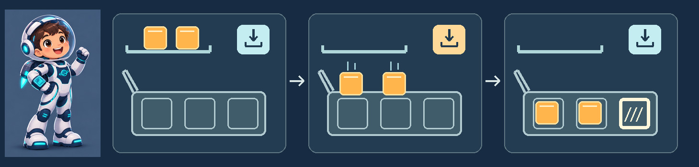

# Moonbase Supply Run

**Engine 1 · Kindergarten · Phase 0**

Design reference for [E01 — Build & Count Quantities](https://github.com/jtron5050/math-game/issues/1).

The child gathers a group of cubes on a tray beside the rover. The open crate shows how many places need filling. Pressing the load button lets the child test their group and see whether the lid can close.

Two cubes wait on the tray. The child presses the load button and both cubes drop. The marked space on the right shows why the lid stays open.

### The first minute

At the landing pad, the astronaut taps a supply cube. It rolls onto the tray and waits there. The astronaut presses the large button with a picture of a cube dropping into a crate. The cube drops into the single space, the lid closes and the rover drives away. It returns with a fresh crate. The astronaut steps aside.

The child can copy the supply tap and the button press. On the next order, a crate with two spaces gives the child a choice. They can press the button after one cube, or gather another first. The demonstration and all feedback work in silence, without written labels or numerals.

### A first trip and a later challenge

**First trip.** Deliver crates with one, two and three outlines. After the third, the rover brings supplies to the landing pad and the visit is complete. Plan for a few minutes, with unlimited time per delivery.

**A later trip.** At base, show the familiar landing pad beside a greenhouse with a larger crate. Choosing the landing pad repeats the small loads. Choosing the greenhouse opens a trip with a row of five outlines, then that same row with two underneath. Keep all the matching cues available.

## How one delivery works

**Look at the crate.** Each outlined space on the crate floor needs one cube. Keep the open crate, the tray and the supply visible together. The tray is unmarked so the child decides how large a group to stage.

**Stage the group.** Each tap on the supply adds one cube to the tray. Tapping a staged cube returns it to the supply. Cubes stay on the tray while the child compares the group with the spaces in the crate. The child can press the load button at any point, including with an empty tray.

**Press to load.** One press tips the tray. Staged cubes drop into open spaces, one cube per space, in reading order across each row. If every space fills before the tray empties, the remaining cubes stay on the tray. Let the child see where the last cube landed before the lid moves.

**Close and deliver.** At the end of the drop, the lid closes only if every space is filled and the tray is empty. The rover then carries the crate away. A held or repeated press during the drop completes just that attempt.

### What a retry looks like

**Too few.** The lid stays raised. Mark each empty space with a thick rim and diagonal stripes. Leave the cubes that landed in place. The child stages more on the tray and presses the same button again. Only the newly staged cubes drop.

**Too many.** The lid stays raised. Outline the leftover cubes on the tray and have the astronaut point back to the supply. The child taps the extras to return them, then presses the load button again. A full crate and an empty tray now let the lid close.

### What changes when five appears

For a crate with five spaces in the top row and two below, imagine the child stages six cubes. Pressing load fills the top row and one space below. The other lower space stays striped and the lid stays up. The child stages one more cube and presses again. It drops beside its partner. Hold the full row and the pair in view for a beat, then close the lid.

## Checking the design without words

### A paper test before building

Use ten counters, a plain saucer for the staging tray, a folded paper lid, crate cards with outlined spaces, and a picture button showing a cube dropping into a crate. Silently model moving a counter onto the saucer, pressing the button, and tipping it into a single-space crate. Close the lid. Give the child a fresh card and wait.

**Watch the staging decision.** Offer a two-space crate. Let the child gather counters and decide when to press. Keep the crate empty until the press. Then move the staged counters into the spaces one at a time. Record separately whether the child chose a group and whether they discovered how to load it.

**Try a short load.** Use a puppet to stage one counter for a two-space crate and press. Keep the lid open. Place a striped ring around the empty space. Watch whether the child stages another counter and presses again. Record any help needed at either step.

**Pass condition.** After the demonstration, look for an independently sent delivery on a fresh card. Record any gesture or adult help needed. If a child succeeds only after someone names a quantity or explains a control, revise that cue and try a fresh card. Keep the paper result separate from later browser testing.

### Browser behavior to verify

Use the project’s astronaut art in a fixed 2D scene. Keep the supply, tray, load button and open spaces in view on small screens. Touch, mouse and keyboard support staging, returning and loading. Give the button a visible press and an accessible name. In reduced motion, show the staged group, the result of the drop and the final lid position as still poses.

Tapping the astronaut replays the demonstration with an example tray and crate. Resume with the child’s staged and loaded cubes intact. Pausing or switching tabs preserves both groups. Each closed crate advances the trip once. A page reload starts at the first demonstration.

Run the route in silence with written labels and numerals hidden. Try an empty tray, a short load, an extra cube and an exact fit. Check that edits affect only the tray, that each press fills only available spaces, and that the child can correct either mismatch without starting over.

### Curriculum reference

Issue #1 maps Engine 1 to Bridges Kindergarten activities 1A Unifix Cubes, 1F Beat You to 5, 2D Beat You to 10 and 3C Five & More. The original supply mission uses one-to-one correspondence and five as a benchmark. The mappings are provisional. [Read issue #1.](https://github.com/jtron5050/math-game/issues/1)
